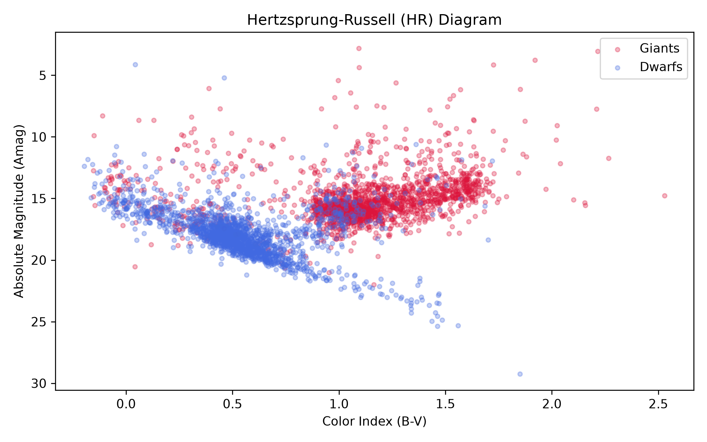
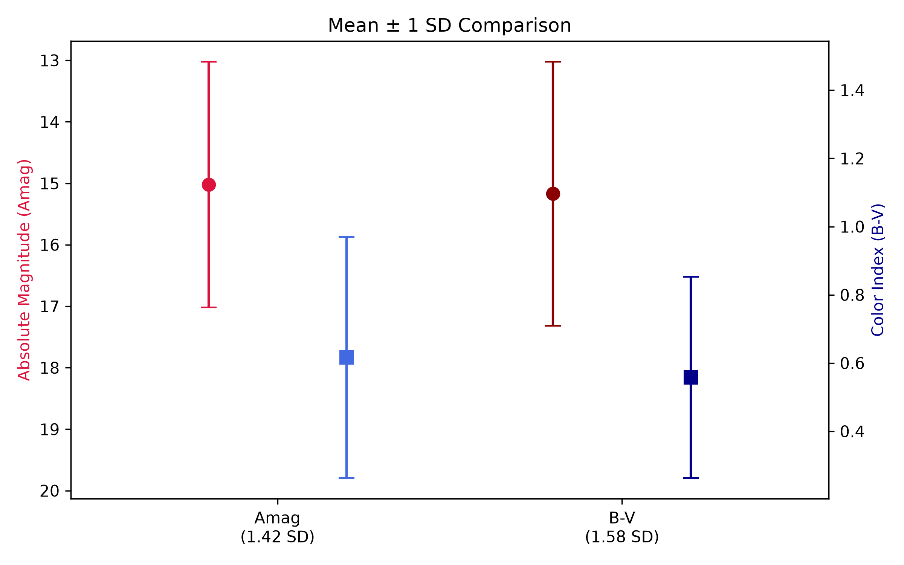
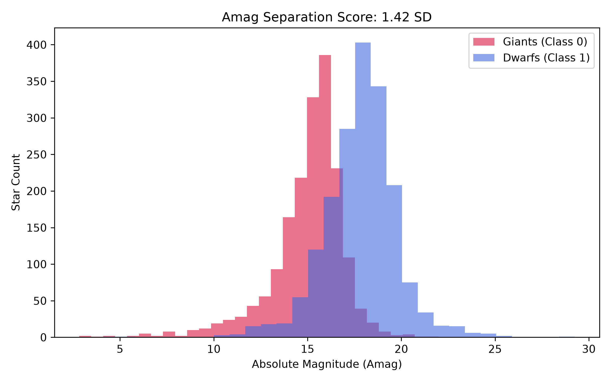
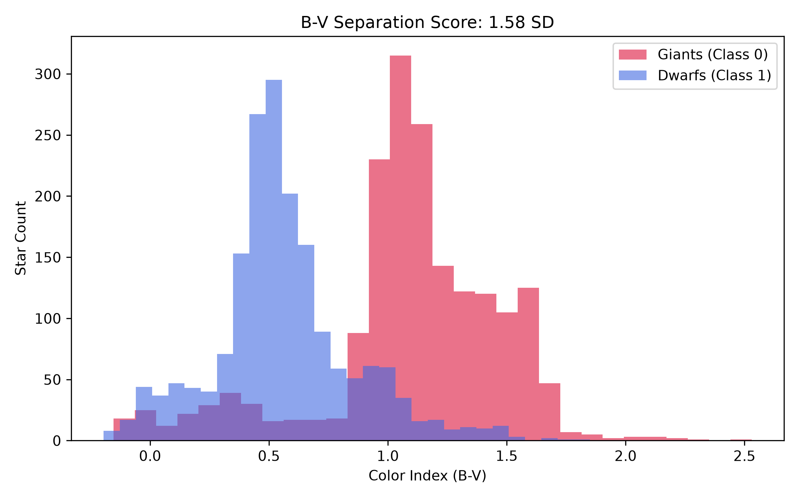

# Stellar Property Discrimination: Dwarfs vs. Giants

A quantitative astronomical data analysis project developed in Python to evaluate whether **Absolute Magnitude ($Amag$)** or **Color Index ($B-V$)** serves as the stronger statistical discriminator between Dwarf and Giant stars.

---

## Scientific Question

> **Which observational parameter—Absolute Magnitude ($Amag$) or Color Index ($B-V$)—provides stronger quantitative separation between Dwarf and Giant stars?**

The analysis performs descriptive statistics, two-sample Welch's t-tests, and computes standardized separation metrics across both parameters using observational data from the Hipparcos catalog.

---

## Dataset & Reproducibility

- **Dataset Source:** The dataset originates from the Hipparcos star catalog and is publicly available on [Kaggle](https://www.kaggle.com/datasets/vinesmsuic/star-categorization-giants-and-dwarfs).
- **File Location:** The dataset file is located in the `data` folder as `stars.csv`.
- **Data Cleaning:** **No manual data cleaning is required.** The Python script automatically cleans missing and invalid entries (`Amag`, `B-V`, `TargetClass`) upon execution using built-in filtering (`dropna`) before performing any calculations.

### Dataset Variables

| Column | Description |
| :--- | :--- |
| `Vmag` | Apparent Visual Magnitude|
| `Plx` | Parallax (milliarcseconds) |
| `e_Plx` | Measurement error in parallax |
| `B-V` | Color index (photometric color) |
| `SpType` | Spectral classification|
| `Amag` | Absolute Magnitude |
| `TargetClass` | Classification label: `0` = Giant, `1` = Dwarf |

---

## Software Dependencies & Setup

- **Python Version:** Python 3.9+
- **IDE:** Visual Studio Code
- **Required Libraries:**
  - `numpy`
  - `pandas`
  - `scipy`
  - `matplotlib`

*(All package dependencies are also cataloged in the `requirements.txt` file)*

---

## How to Run the Code Manually in VS Code

### Step 1: Download and Open the Project
1. Click the green **Code** button at the top right of this GitHub page and select **Download ZIP**.
2. Extract the downloaded folder on your laptop.
3. Open Visual Studio Code.
4. Go to the top menu and select **File > Open Folder...**.
5. Select and open the extracted project folder (`IntroToProgramming`).

### Step 2: Configure Environment & Dependencies
1. Make sure the official **Python extension** is installed via the Extensions tab on the left sidebar.
2. When opening `analysis.py`, VS Code will automatically detect your local Python environment and installed scientific libraries (`numpy`, `pandas`, `scipy`, `matplotlib`).

### Step 3: Execute the Script
1. In the VS Code left sidebar (Explorer), open the `src` folder.
2. Click on `analysis.py` to open the file in the editor.
3. Click the **Run Python File** button at the top right of the editor window.
4. The statistical outputs and test results will display in the bottom panel.
5. All generated plots will be saved directly into the `figures/` folder.

---

## Results & Visualizations

### Observational Hertzsprung–Russell (H–R) Diagram

### Separation & Error Bars

### Parameter Distribution Histograms

| Absolute Magnitude ($Amag$) | Color Index ($B - V$) |
| :---: | :---: |
|  |  |
